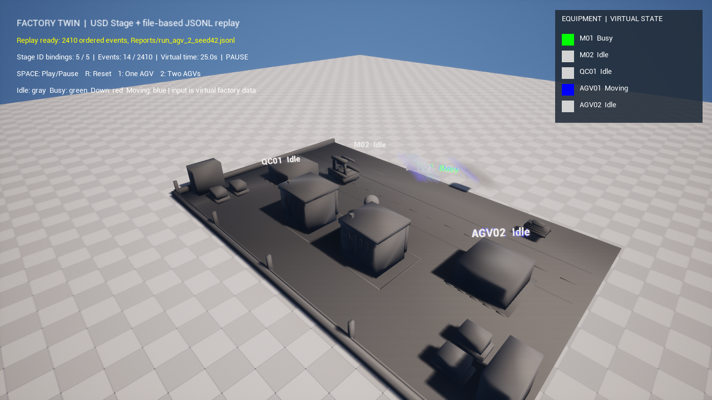

# FactoryTwinUE — OpenUSD 기반 소형 공장 디지털 트윈

**OpenUSD · Unreal Engine 5.8/C++ · Python · NVIDIA Omniverse Kit Extension**

입고 → 가공 설비 2대 → 품질 검사 → 출고 공정을 **AGV 1대/2대**로 비교하는 포트폴리오용 디지털 트윈 프로토타입입니다. Python이 공정 상태와 KPI를 결정하고, OpenUSD는 공간·설비 모델을 공유하며, Unreal은 동일한 JSONL 이벤트를 재생합니다. **실제 공장 데이터가 아닌 합성 시뮬레이션**입니다.



## 핵심 기능

- **결정적 이벤트 재생:** Python 시뮬레이터 → `JSONL`(가상 시간·설비 ID·상태) + `CSV`(KPI) → UE5 리플레이. 상태를 C++에서 다시 시뮬레이션하지 않습니다.
- **AGV 조건 비교:** 같은 시드와 작업 유입 조건에서 AGV 1대/2대 실험. 시드 42의 작업 완료 수는 각각 **49건 / 153건**입니다(합성 모델의 결과).
- **5개 고정 설비 ID:** `M01`, `M02`, `QC01`, `AGV01`, `AGV02`. `equipment_manifest.json`과 USD `twin:equipmentId`를 대조합니다.
- **교체 가능한 3D 모델:** `data/visual_assets.json`에서 ID별 USD 경로·스케일·회전을 변경합니다. `/World/Factory/.../{ID}/Geometry`의 외부 USD Reference만 바꿔 ID·배치·이벤트를 유지하고 **C++ 재컴파일 없이 Stage 재로드**가 가능합니다.
- **화면 검증:** UE5.8 D3D11에서 실제 USD 설비, AGV 이동·표시 전환, `Idle / Busy / Down / Moving` 상태 재생을 확인했습니다.

## 데이터 흐름

```text
data/scenarios/agv_{1,2}.json
        ↓ Python factory_sim (single source of truth)
Reports/run_agv_*_seed42.jsonl + Reports/kpi.csv
        ↓ event-sourced playback
USD Stage + equipment_manifest.json → Unreal Engine 5.8 / C++
        ↑
usd/factory_scene.usda → usd/layout.usda → usd/prefabs/*.usda
                              ↑ data/visual_assets.json
```

## 빠른 실행 — Windows PowerShell

아래 명령은 **저장소 루트(`FactoryTwin.uproject`가 있는 폴더)**에서 실행합니다. Python 3.14와 Unreal Engine 5.8이 필요합니다.

```powershell
py -3.14 -m venv .venv
.\.venv\Scripts\python.exe -m pip install --only-binary=:all: usd-core==26.8
.\.venv\Scripts\python.exe python/tools/build_usd.py --validate-only
.\.venv\Scripts\python.exe python/tools/test_model_swap.py
$env:PYTHONPATH = 'python'
.\.venv\Scripts\python.exe -m unittest discover -s tests -v
.\.venv\Scripts\python.exe -m factory_sim.runner --scenario data/scenarios/agv_1.json --seed 42 --out Reports/run_agv_1_seed42.jsonl --kpi-out Reports/kpi.csv
.\.venv\Scripts\python.exe -m factory_sim.runner --scenario data/scenarios/agv_2.json --seed 42 --out Reports/run_agv_2_seed42.jsonl --kpi-out Reports/kpi.csv
.\.venv\Scripts\python.exe python/tools/compare.py --csv Reports/kpi.csv --out Reports/compare.md
```

UE5.8을 설치한 뒤 **`UE_ROOT` 환경변수를 해당 엔진 폴더로 설정**하고 다음을 실행합니다. `USDImporter`/`USDCore` 플러그인이 필요합니다.

```powershell
& (Join-Path $env:UE_ROOT 'Engine\Build\BatchFiles\Build.bat') FactoryTwinEditor Win64 Development "-Project=$((Resolve-Path .\FactoryTwin.uproject).Path)" -WaitMutex -NoHotReload
& (Join-Path $env:UE_ROOT 'Engine\Binaries\Win64\UnrealEditor.exe') (Resolve-Path .\FactoryTwin.uproject).Path -game -dx11
```

리플레이 조작: **`1`** AGV 1대, **`2`** AGV 2대, **`Space`** 재생/일시정지, **`R`** 초기화.

### 3D 모델 교체 예시

```powershell
.\.venv\Scripts\python.exe python/tools/set_visual_asset.py --id M01 --asset usd/prefabs/alternate_sphere.usda --scale 2,2,2 --rotation 0,0,0 --dry-run
```

실제 적용 시 USD Stage를 사용 중인 UE/Kit을 닫고 `--dry-run`을 제거한 뒤 실행하고 Stage를 다시 엽니다. 현재 기본 프리팹은 `factory_machine.usda`, `factory_inspection.usda`, `factory_agv.usda`입니다. [모델 교체 가이드](Docs/model_swap_usd.md) · [UE 시각 교체 검증](Docs/model_swap_unreal.md)

## 프로젝트 구성

| 경로 | 역할 |
| --- | --- |
| `usd/`, `data/visual_assets.json` | Z-up·1m OpenUSD Stage, 장비별 교체형 참조 모델 |
| `data/equipment_manifest.json` | 5개 설비 ID ↔ USD prim 경로 |
| `python/factory_sim/`, `data/scenarios/` | 결정적 시뮬레이션·AGV 1/2 시나리오 |
| `python/tools/`, `tests/` | USD 생성·모델 교체·KPI 비교·테스트 |
| `Source/FactoryTwin/`, `FactoryTwin.uproject` | UE5.8 C++ USD 바인딩·JSONL 재생·HUD |
| `exts/com.factory.twin/` | Kit Extension 구현(실제 Kit GUI 검증 전) |
| `Reports/`, `Docs/` | 실행 결과·로그·실제 D3D11 캡처·검증 문서 |

## 검증 상태 및 범위

- **PASS:** Python 테스트 **23/23**, USD 모델 교체 테스트 **5/5**, `pxr.Usd.Stage.Open` 및 모델 참조·ID 검증.
- **PASS:** UE5.8 Development 빌드와 **실제 Windows D3D11** 상태 리플레이·AGV 이동·모델 교체 시각 QA. [UE 검증 기록](Docs/unreal_evidence.md)
- **NOT RUN:** NVIDIA Kit 애플리케이션의 Extension 활성화/버튼·GUI 검증. 공식 템플릿 부트스트랩까지 진행했고 **NVIDIA 라이선스 동의 단계에서 중단**했습니다. [Kit 검증 기록](Docs/kit_evidence.md)
- **미구현/제외:** 실시간 MES·센서 연결, 충돌 물리·자율 경로 계획, Isaac Sim/Lab, CAD STEP 파이프라인, 통합 데모 영상. P0 스냅샷: **구현 93% / 검증 64%**(2026-10-20 기준).

더 보기: [시뮬레이션·재현 조건](Docs/simulation.md) · [UE 실행/캡처](Docs/demo_capture.md) · [Kit 환경](Docs/kit_environment.md)
